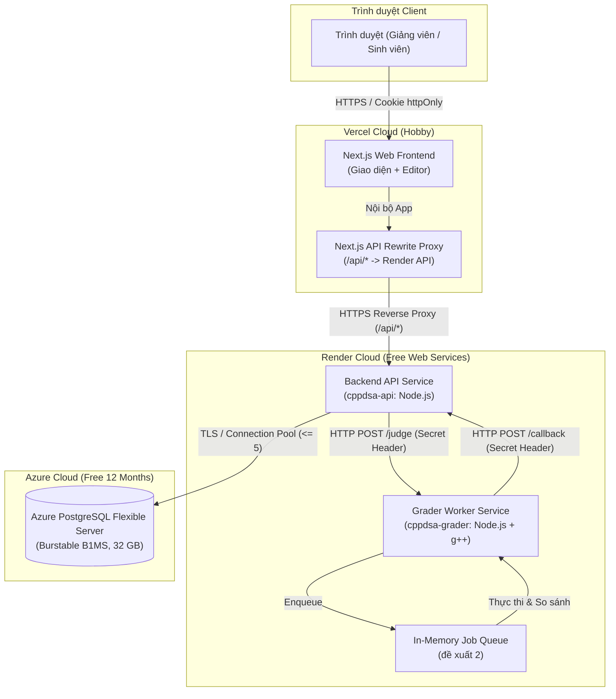
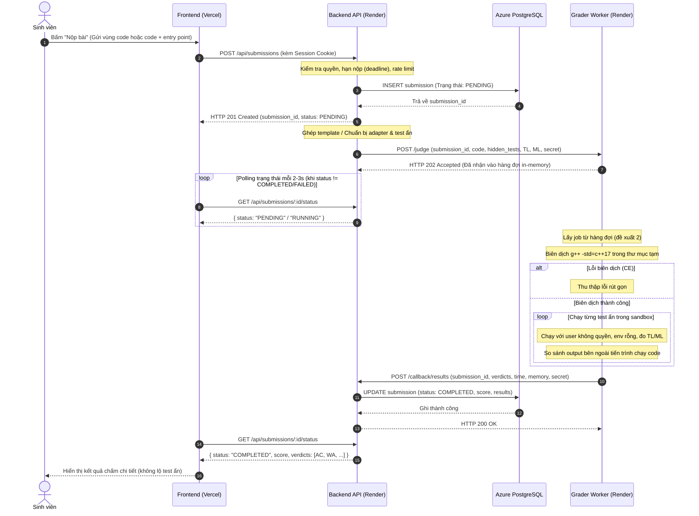
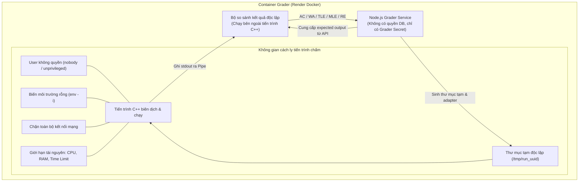

# Kiến trúc hệ thống CppDSA (ARCHITECTURE)

Tài liệu đặc tả kiến trúc, phân bổ thành phần, luồng xử lý và mô hình bảo mật của hệ thống chấm bài thực hành CppDSA.

---

## 1. Tổng quan các thành phần hệ thống

Hệ thống được thiết kế theo mô hình phân tán chi phí tối ưu, tận dụng tối đa các gói tài nguyên đám mây miễn phí nhằm đảm bảo chi phí vận hành bằng 0 USD.

| Thành phần | Nền tảng triển khai | Công nghệ cốt lõi | Trách nhiệm chính |
|---|---|---|---|
| **Frontend** | Vercel (Hobby Tier) | Next.js, React [ĐỀ XUẤT], TailwindCSS [ĐỀ XUẤT], Monaco Editor [ĐỀ XUẤT] | Cung cấp giao diện người dùng cho Giảng viên và Sinh viên; xử lý rewrite URL `/api/*` về Render API [CẦN XÁC MINH điều khoản Vercel Hobby cho mục đích giảng dạy]. Không kết nối trực tiếp cơ sở dữ liệu. |
| **Backend API** | Render (Free Web Service) | Node.js, Express/Fastify [ĐỀ XUẤT], TypeScript, Docker | Quản lý người dùng, lớp học, bài tập, phân quyền RBAC; lưu trữ và điều phối bài nộp; thành phần duy nhất có quyền kết nối cơ sở dữ liệu. |
| **Grader Worker** | Render (Free Web Service) | Node.js, GCC (`g++ -std=c++17`), Docker | Nhận job nộp bài qua HTTP từ API; quản lý hàng đợi in-memory; biên dịch và chạy cách ly code sinh viên; so sánh kết quả và callback về API [CẦN XÁC MINH Render có region Singapore cho free]. Không giữ credential cơ sở dữ liệu. |
| **Database** | Azure Database for PostgreSQL | PostgreSQL Flexible Server (Burstable B1MS) | Lưu trữ tài khoản, lớp học, bài tập, template, bộ test ẩn, lịch sử nộp bài và kết quả chi tiết từng test. Miễn phí 12 tháng (750 giờ/tháng, 32 GB lưu trữ) [CẦN XÁC MINH ngày bắt đầu 12 tháng free của Azure trong Cost Management]. |

---

## 2. Sơ đồ kiến trúc tổng thể (System Architecture)

---

## 3. Luồng nộp bài và chấm tự động (Submission Flow)

Quy trình nộp bài được thiết kế không sử dụng cơ chế polling cơ sở dữ liệu (Database Polling) nhằm bảo vệ năng lực xử lý của Azure PostgreSQL B1MS.

### Các bước chi tiết trong luồng chấm:
1. **Tiếp nhận bài nộp:** Sinh viên gửi mã nguồn (hoặc nội dung các vùng code) qua giao diện. Next.js proxy yêu cầu tới Backend API.
2. **Khởi tạo bản ghi:** API xác thực quyền, kiểm tra deadline bài tập, lưu bản ghi vào PostgreSQL với trạng thái `PENDING` và trả về mã bài nộp cho client.
3. **Điều phối tới Grader:** API chuẩn bị mã nguồn hoàn chỉnh (ghép template hoặc tạo adapter) cùng danh sách test case ẩn, sau đó gửi HTTP POST tới endpoint `/judge` của Grader với header xác thực nội bộ (`X-Grader-Secret`).
4. **Xếp hàng và thực thi tại Grader:** Grader tiếp nhận job, đưa vào hàng đợi bộ nhớ nội bộ (in-memory queue). Worker chạy song song giới hạn (đề xuất 2, chỉnh theo số đo P2/P8) để tránh làm quá tải CPU.
5. **Biên dịch và chấm test:**
   - Grader tạo thư mục làm việc tạm thời trong `/tmp`.
   - Biên dịch bằng `g++ -std=c++17 -O2`. Nếu thất bại, ghi nhận verdict `CE` kèm thông báo lỗi đã được lọc/rút gọn.
   - Nếu biên dịch thành công, lần lượt thực thi mã nguồn đối với từng test ẩn với giới hạn thời gian (TL) và bộ nhớ (ML).
   - So sánh output sinh viên với đáp án bằng tiến trình Node.js bên ngoài, sau khi loại bỏ khoảng trắng thừa cuối dòng và cuối file.
6. **Báo cáo kết quả (Callback):** Grader gửi HTTP POST `/callback/results` kèm secret token về API.
7. **Cập nhật dữ liệu:** API xác thực secret token, cập nhật trạng thái bài nộp thành `COMPLETED` cùng điểm số và verdict từng test vào PostgreSQL.
8. **Hiển thị kết quả:** Frontend polling trạng thái mỗi 2–3 giây; ngay khi nhận trạng thái hoàn tất, giao diện hiển thị bảng điểm và danh sách verdict của các test ẩn.

---

## 4. Kiến trúc xác thực và phân quyền (Authentication & Authorization)

### 4.1. Quản lý phiên làm việc (Session Management)
- Hệ thống sử dụng cơ chế xác thực dựa trên cookie `httpOnly`, mang cờ `Secure` và `SameSite=Lax`.
- Nhờ cơ chế **Next.js Rewrite** tại Vercel (`/api/*` chuyển tiếp tới domain Render API), trình duyệt coi cả Frontend và API đều chung một origin, giúp giảm thiểu các hạn chế về cookie bên thứ ba (third-party cookies) [CẦN XÁC MINH rewrite /api/* cùng origin giải quyết được cookie theo PROJECT_PLAN 3.5].
- Mật khẩu người dùng được băm an toàn bằng thuật toán Argon2id (hoặc Bcrypt với chi phí salt phù hợp).

### 4.2. Khởi tạo tài khoản và phân quyền (RBAC)
- **Tài khoản Giảng viên đầu tiên:** Được khởi tạo an toàn thông qua CLI database seed script khi dựng hệ thống; không hỗ trợ đăng ký công khai (Public Registration) để ngăn chặn truy cập trái phép.
- **Tài khoản Sinh viên:** Do giảng viên import hàng loạt từ danh sách lớp (file CSV). Hệ thống tự tạo mật khẩu ngẫu nhiên tạm thời và gắn cờ `must_change_password = true`.
- **Đổi mật khẩu bắt buộc:** Ở lần đăng nhập đầu tiên, sinh viên bắt buộc phải đổi mật khẩu mới thì mới được cấp phiên làm việc chính thức.
- **Quên mật khẩu:** Giảng viên sử dụng chức năng reset mật khẩu trên giao diện quản trị lớp để cấp lại mật khẩu tạm mới cho sinh viên.
- **Kiểm soát truy cập tại Backend:** Mọi logic phân quyền (không cho sinh viên đọc test ẩn, không cho sinh viên xem bài nộp của người khác, chỉ giảng viên mới được sửa bài tập) đều được thực thi chặt chẽ tại tầng Backend API, không phụ thuộc vào việc ẩn nút bấm ở giao diện Frontend.

---

## 5. Mô hình an ninh và cách ly môi trường chấm (Grader Security & Sandbox)

Chương trình do sinh viên nộp là **mã nguồn không tin cậy (untrusted code)**. Hệ thống áp dụng nguyên tắc phòng thủ đa lớp (Defense-in-depth) để giảm thiểu rủi ro cho hạ tầng Render và tăng cường bảo mật của dữ liệu:

### Các biện pháp an ninh chi tiết:
1. **Bảo mật dữ liệu Test ẩn (Expected Output Isolation):**
   - Đáp án kỳ vọng (expected output) của bài toán không bao giờ được lưu vào filesystem hoặc nạp vào bộ nhớ của tiến trình chạy code sinh viên.
   - Quá trình chạy code chỉ nhận input từ stdin hoặc tham số hàm. Dữ liệu stdout được pipe trực tiếp sang tiến trình Node.js của Grader để so sánh độc lập.
2. **Chạy dưới quyền tối thiểu (Least Privilege):**
   - Tiến trình thực thi code sinh viên chạy dưới người dùng không có đặc quyền hệ thống (`nobody` hoặc user unprivileged riêng).
   - Chặn toàn bộ quyền truy cập vào các thư mục hệ thống quan trọng (`/etc`, `/root`, `/var`).
3. **Môi trường biến rỗng (Clean Environment):**
   - Tiến trình chạy code được khởi tạo với cờ làm sạch toàn bộ biến môi trường (`env -i`).
   - Không chứa connection string, secret token hay thông tin hạ tầng trong biến môi trường.
4. **Không nắm giữ khóa cơ sở dữ liệu:**
   - Dịch vụ Grader Worker không được cấp bất kỳ thông tin kết nối hay credential nào của Azure PostgreSQL. Mọi giao tiếp dữ liệu đều thông qua API; firewall database chỉ mở cho IP Render [CẦN XÁC MINH Render cung cấp outbound IP cho free service].
5. **Thư mục làm việc tạm thời và tự hủy:**
   - Mỗi submission được cấp phát một thư mục ngẫu nhiên riêng biệt nằm trong `/tmp`.
   - Toàn bộ tệp mã nguồn, file thực thi và tệp kết quả tạm thời được dọn dẹp sạch sẽ ngay sau khi hoàn thành chấm bài.
6. **Chặn kết nối mạng (Network Restriction):**
   - Tiến trình chạy code sinh viên bị chặn khả năng mở socket hoặc tạo kết nối mạng ra bên ngoài.
7. **Bảo vệ chế độ Template:**
   - Trình duyệt chỉ gửi nội dung vùng sinh viên viết; Server lưu template gốc và thực hiện ghép nối. Sinh viên không thể thay thế hàm `main()` hoặc ghi đè logic kiểm thử.
8. **Bảo vệ chế độ Free Mode:**
   - Sử dụng cơ chế Adapter C++ do hệ thống sinh ra; sinh viên chỉ nộp hàm/lớp thuật toán. Adapter chịu trách nhiệm gọi hàm và in kết quả theo định dạng chuẩn hóa.

---

## 6. Xử lý sự cố và phục hồi lỗi (Fault Tolerance & Cold Start)

1. **Khắc phục hiện tượng Render Free Sleep (Cold Start):**
   - Các web service miễn phí trên Render sẽ chuyển sang trạng thái ngủ (sleep) sau 15 phút không nhận được lưu lượng truy cập; thời gian đánh thức mất khoảng 1 phút (theo PROJECT_PLAN mục 3.3).
   - Giải pháp: Cung cấp nút "Khởi động hệ thống" trên giao diện giảng viên để gửi request đồng thời tới API và Grader trước buổi thực hành vài phút (theo PROJECT_PLAN mục 3.3).
2. **Khôi phục bài nộp khi Grader bị khởi động lại:**
   - Hàng đợi của Grader là in-memory queue. Nếu Grader bị restart đột ngột, các job đang xử lý có thể bị gián đoạn.
   - Cơ chế tự phục hồi: Mỗi khi Backend API tiếp nhận một request bất kỳ từ client, API sẽ kiểm tra các bản ghi submission đang ở trạng thái `PENDING` hoặc `RUNNING` quá thời gian 2 phút. Hệ thống sẽ tự động gửi lại job sang Grader (tối đa 2 lần retry). Nếu sau 2 lần retry vẫn thất bại, bản ghi được cập nhật trạng thái `SYSTEM_ERROR` để sinh viên và giảng viên nhận biết.
3. **Quản lý kết nối cơ sở dữ liệu (Azure PostgreSQL B1MS):**
   - B1MS có tài nguyên thấp (PROJECT_PLAN mục 3.2). Do đó backend API cấu hình connection pool nhỏ (đề xuất tối đa 5 kết nối) [CẦN XÁC MINH giới hạn kết nối của B1MS].
   - Endpoint kiểm tra sức khỏe `/healthz` của API không thực hiện query vào database để tránh tiêu tốn tài nguyên.
   - Áp dụng cơ chế retry với exponential backoff khi gặp lỗi gián đoạn kết nối mạng tạm thời.
