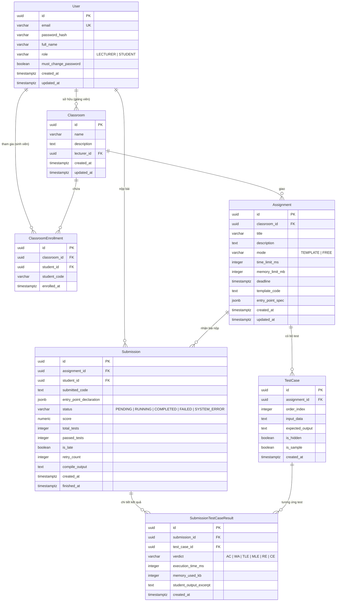

# Mô hình dữ liệu hệ thống CppDSA (DATA_MODEL)

Tài liệu đặc tả cấu trúc cơ sở dữ liệu, các thực thể, thuộc tính, khóa chính/ngoại, quan hệ và đặc tả vị trí lưu trữ dữ liệu của hệ thống CppDSA trên nền tảng Azure PostgreSQL.

---

## 1. Sơ đồ thực thể quan hệ (Entity-Relationship Diagram)

---

## 2. Đặc tả chi tiết các bảng dữ liệu

### 2.1. Bảng `users` (Tài khoản người dùng)
Lưu thông tin người dùng trong hệ thống (Giảng viên và Sinh viên).
- `id` (UUID, Khóa chính, Mặc định: `gen_random_uuid()`): Mã định danh duy nhất của người dùng.
- `email` (VARCHAR(255), Bắt buộc, Duy nhất): Địa chỉ email đăng nhập.
- `password_hash` (VARCHAR(255), Bắt buộc): Chuỗi mật khẩu đã băm bằng Argon2id hoặc Bcrypt.
- `full_name` (VARCHAR(150), Bắt buộc): Họ và tên người dùng.
- `role` (VARCHAR(20), Bắt buộc): Quyền người dùng, nhận một trong hai giá trị: `'LECTURER'` hoặc `'STUDENT'`.
- `must_change_password` (BOOLEAN, Mặc định: `FALSE`): Đánh dấu tài khoản dùng mật khẩu tạm thời, bắt buộc đổi mật khẩu ở lần đăng nhập tiếp theo.
- `created_at` (TIMESTAMPTZ, Mặc định: `CURRENT_TIMESTAMP`): Thời điểm tạo tài khoản.
- `updated_at` (TIMESTAMPTZ, Mặc định: `CURRENT_TIMESTAMP`): Thời điểm cập nhật thông tin.

### 2.2. Bảng `classrooms` (Lớp học)
Lưu thông tin các lớp học do giảng viên phụ trách.
- `id` (UUID, Khóa chính, Mặc định: `gen_random_uuid()`): Mã định danh duy nhất của lớp học.
- `name` (VARCHAR(200), Bắt buộc): Tên lớp học (ví dụ: "DSA - Nhóm 01 - HK1 2026").
- `description` (TEXT, Cho phép rỗng): Mô tả chi tiết hoặc thông tin giảng đường/buổi học.
- `lecturer_id` (UUID, Khóa ngoại tham chiếu `users(id)`, Bắt buộc): Mã giảng viên quản lý lớp.
- `created_at` (TIMESTAMPTZ, Mặc định: `CURRENT_TIMESTAMP`): Thời điểm tạo lớp.
- `updated_at` (TIMESTAMPTZ, Mặc định: `CURRENT_TIMESTAMP`): Thời điểm cập nhật thông tin.

### 2.3. Bảng `classroom_enrollments` (Ghi danh lớp học)
Bảng trung gian quản lý danh sách sinh viên tham gia từng lớp học.
- `id` (UUID, Khóa chính, Mặc định: `gen_random_uuid()`): Mã bản ghi ghi danh.
- `classroom_id` (UUID, Khóa ngoại tham chiếu `classrooms(id)`, Bắt buộc): Mã lớp học.
- `student_id` (UUID, Khóa ngoại tham chiếu `users(id)`, Bắt buộc): Mã sinh viên tham gia.
- `student_code` (VARCHAR(50), Bắt buộc): Mã số sinh viên (MSSV) phục vụ đối chiếu và xuất bảng điểm.
- `enrolled_at` (TIMESTAMPTZ, Mặc định: `CURRENT_TIMESTAMP`): Thời điểm thêm sinh viên vào lớp.
- *Ràng buộc duy nhất (Unique Constraint):* `UNIQUE(classroom_id, student_id)`.

### 2.4. Bảng `assignments` (Bài tập thực hành)
Lưu thông tin đề bài, cấu hình kiểm thử và mã khung template.
- `id` (UUID, Khóa chính, Mặc định: `gen_random_uuid()`): Mã định danh duy nhất của bài tập.
- `classroom_id` (UUID, Khóa ngoại tham chiếu `classrooms(id)`, Bắt buộc): Lớp học được giao bài tập.
- `title` (VARCHAR(255), Bắt buộc): Tiêu đề bài tập (ví dụ: "Đảo ngược danh sách liên kết đơn").
- `description` (TEXT, Bắt buộc): Mô tả đề bài, ví dụ mẫu minh họa và hướng dẫn làm bài.
- `mode` (VARCHAR(20), Bắt buộc): Chế độ bài tập, nhận giá trị: `'TEMPLATE'` hoặc `'FREE'`.
- `time_limit_ms` (INTEGER, Bắt buộc, Mặc định: `1000`): Giới hạn thời gian chạy cho mỗi test case (tính bằng milliseconds).
- `memory_limit_mb` (INTEGER, Bắt buộc, Mặc định: `256`): Giới hạn bộ nhớ cho mỗi test case (tính bằng megabytes).
- `deadline` (TIMESTAMPTZ, Bắt buộc): Thời hạn nộp bài.
- `template_code` (TEXT, Cho phép rỗng): **Nơi lưu mã template gốc** chứa các cặp chú thích `// STUDENT_BEGIN <tên>` và `// STUDENT_END` (sử dụng khi `mode = 'TEMPLATE'`).
- `entry_point_spec` (JSONB, Cho phép rỗng): Cấu hình định nghĩa giao diện hàm/lớp chấm (kiểu dữ liệu tham số và kiểu trả về) sử dụng cho `mode = 'FREE'`.
- `created_at` (TIMESTAMPTZ, Mặc định: `CURRENT_TIMESTAMP`): Thời điểm tạo bài tập.
- `updated_at` (TIMESTAMPTZ, Mặc định: `CURRENT_TIMESTAMP`): Thời điểm cập nhật bài tập.

### 2.5. Bảng `test_cases` (Bộ kiểm thử bài tập)
**Nơi lưu trữ các bộ kiểm thử ẩn và công khai**.
- `id` (UUID, Khóa chính, Mặc định: `gen_random_uuid()`): Mã định danh test case.
- `assignment_id` (UUID, Khóa ngoại tham chiếu `assignments(id)`, Bắt buộc): Bài tập sở hữu test case.
- `order_index` (INTEGER, Bắt buộc, Mặc định: `1`): Thứ tự chạy của test case (Test 1, Test 2...).
- `input_data` (TEXT, Bắt buộc): Dữ liệu đầu vào cung cấp cho chương trình kiểm thử.
- `expected_output` (TEXT, Bắt buộc): **Nơi lưu kết quả đáp án kỳ vọng** chuẩn mực của bài toán.
- `is_hidden` (BOOLEAN, Bắt buộc, Mặc định: `TRUE`): Đánh dấu test ẩn (`TRUE`: dùng để chấm điểm chính thức, không trả về client; `FALSE`: test mẫu cho sinh viên tham khảo).
- `is_sample` (BOOLEAN, Bắt buộc, Mặc định: `FALSE`): Đánh dấu test mẫu hiển thị trong mô tả đề bài.
- `created_at` (TIMESTAMPTZ, Mặc định: `CURRENT_TIMESTAMP`): Thời điểm tạo test case.

### 2.6. Bảng `submissions` (Bài nộp của sinh viên)
**Nơi lưu trữ bài nộp và mã nguồn của sinh viên**.
- `id` (UUID, Khóa chính, Mặc định: `gen_random_uuid()`): Mã định danh bài nộp.
- `assignment_id` (UUID, Khóa ngoại tham chiếu `assignments(id)`, Bắt buộc): Bài tập được nộp.
- `student_id` (UUID, Khóa ngoại tham chiếu `users(id)`, Bắt buộc): Sinh viên thực hiện nộp bài.
- `submitted_code` (TEXT, Bắt buộc): **Nơi lưu mã nguồn sinh viên**. Đối với Template mode, lưu nội dung các vùng sinh viên (dưới dạng chuỗi JSON map `{ "tên_vùng": "mã_nguồn" }` hoặc văn bản vùng). Đối với Free mode, lưu toàn bộ file mã nguồn C++ do sinh viên tự viết.
- `entry_point_declaration` (JSONB, Cho phép rỗng): Khai báo điểm vào ở Free mode (ví dụ `{ "entry_type": "function", "entry_name": "myCustomSolve" }`).
- `status` (VARCHAR(20), Bắt buộc, Mặc định: `'PENDING'`): Trạng thái xử lý bài nộp (`'PENDING'`, `'RUNNING'`, `'COMPLETED'`, `'FAILED'`, `'SYSTEM_ERROR'`).
- `score` (NUMERIC(5, 2), Mặc định: `0.00`): Điểm số đạt được của lần nộp (thang điểm 10 hoặc tỷ lệ test đạt).
- `total_tests` (INTEGER, Mặc định: `0`): Tổng số test ẩn được chấm.
- `passed_tests` (INTEGER, Mặc định: `0`): Số lượng test ẩn đạt kết quả AC.
- `is_late` (BOOLEAN, Bắt buộc, Mặc định: `FALSE`): Đánh dấu bài nộp thực hiện sau thời hạn `deadline` (chỉ dùng luyện tập, không tính điểm chính thức).
- `retry_count` (INTEGER, Bắt buộc, Mặc định: `0`): Số lần hệ thống tự động retry khi worker gặp sự cố (tối đa 2 lần).
- `compile_output` (TEXT, Cho phép rỗng): Thông báo lỗi biên dịch rút gọn (chỉ lưu khi gặp lỗi `CE`).
- `created_at` (TIMESTAMPTZ, Mặc định: `CURRENT_TIMESTAMP`): Thời điểm sinh viên bấm nộp bài.
- `finished_at` (TIMESTAMPTZ, Cho phép rỗng): Thời điểm hoàn tất quá trình chấm bài.

### 2.7. Bảng `submission_test_results` (Kết quả chi tiết từng test)
**Nơi lưu trữ kết quả kiểm thử của từng test case cho mỗi bài nộp**.
- `id` (UUID, Khóa chính, Mặc định: `gen_random_uuid()`): Mã định danh kết quả test.
- `submission_id` (UUID, Khóa ngoại tham chiếu `submissions(id)`, Bắt buộc): Bài nộp tương ứng.
- `test_case_id` (UUID, Khóa ngoại tham chiếu `test_cases(id)`, Bắt buộc): Test case được chấm.
- `verdict` (VARCHAR(10), Bắt buộc): Trạng thái đánh giá (`'AC'`, `'WA'`, `'TLE'`, `'MLE'`, `'RE'`, `'CE'`).
- `execution_time_ms` (INTEGER, Cho phép rỗng): Thời gian thực thi thực tế (milliseconds).
- `memory_used_kb` (INTEGER, Cho phép rỗng): Dung lượng bộ nhớ thực tế sử dụng (kilobytes).
- `student_output_excerpt` (TEXT, Cho phép rỗng): Trích đoạn ngắn kết quả in ra của sinh viên (chỉ giảng viên được xem để chẩn đoán lỗi, không gửi cho sinh viên).
- `created_at` (TIMESTAMPTZ, Mặc định: `CURRENT_TIMESTAMP`): Thời điểm ghi nhận kết quả.
- *Ràng buộc duy nhất (Unique Constraint):* `UNIQUE(submission_id, test_case_id)`.

---

## 3. Tổng kết vị trí lưu trữ các thực thể trọng yếu

| Thực thể dữ liệu | Nơi lưu trữ vật lý trong cơ sở dữ liệu | Ghi chú bảo mật & toàn vẹn |
|---|---|---|
| **Mã Template** | `assignments.template_code` | Chỉ Giảng viên có quyền sửa; sinh viên chỉ đọc nội dung đề. |
| **Vùng code sinh viên** | `submissions.submitted_code` | Ghi nhận bất biến (immutable) tại thời điểm nộp; sinh viên chỉ được đọc bài nộp của chính mình. |
| **Bộ kiểm thử ẩn (Hidden Tests)** | `test_cases` (với `is_hidden = TRUE`) | Không bao giờ trả về client sinh viên qua bất kỳ API nào. |
| **Thông tin bài nộp (Submission)** | `submissions` | Lưu trạng thái hàng đợi, điểm tổng, thời gian nộp và cờ nộp trễ. |
| **Kết quả từng test ẩn** | `submission_test_results` | Sinh viên chỉ được xem `verdict`, `execution_time_ms`, `memory_used_kb`; không xem được input hay expected output. |

---

## 4. Các chỉ mục tối ưu hóa hiệu năng (Indexes)

Nhằm tối ưu hóa năng lực xử lý cho gói Azure Database for PostgreSQL Flexible Server B1MS, các chỉ mục được thiết lập có chủ đích:
1. `CREATE INDEX idx_classrooms_lecturer ON classrooms(lecturer_id);`
2. `CREATE INDEX idx_enrollments_student ON classroom_enrollments(student_id);`
3. `CREATE INDEX idx_enrollments_classroom ON classroom_enrollments(classroom_id);`
4. `CREATE INDEX idx_assignments_classroom ON assignments(classroom_id);`
5. `CREATE INDEX idx_testcases_assignment ON test_cases(assignment_id, order_index);`
6. `CREATE INDEX idx_submissions_assignment_student ON submissions(assignment_id, student_id, created_at DESC);`
7. `CREATE INDEX idx_submissions_status ON submissions(status) WHERE status IN ('PENDING', 'RUNNING');` (Partial Index tối ưu cho việc quét phục hồi job treo)
8. `CREATE INDEX idx_sub_results_submission ON submission_test_results(submission_id);`
